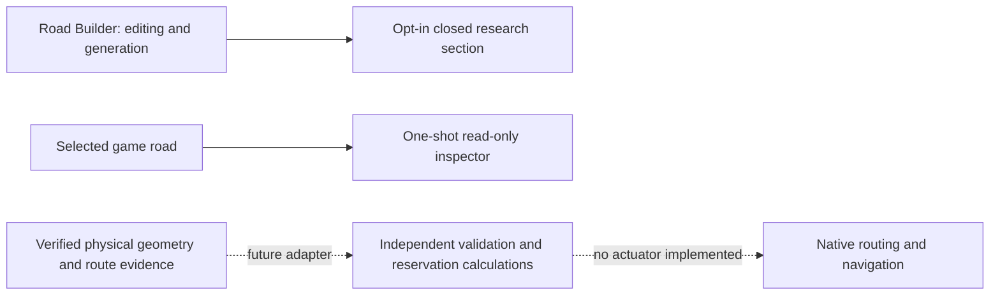

# Architecture and invariants

## Boundaries

`src/Twtl.Core` targets netstandard2.0 and contains no engine types. `src/Twtl.Mod` targets net472, following the inspected Road Builder project, and uses the official CS2 build imports. This framework choice is source-based, not proof of the actual current game's runtime profile. The mod adapter references the real RoadBuilder.dll with copy-local disabled. The core is packaged as a separate managed dependency. `tests/Twtl.Core.Tests` targets net8.0 and runs as a console process with explicit failure exit status.

There are no Harmony patches, navigation replacements, ECS writes to traffic components or overlapping road networks. API auditing uses reflection only to read signatures. A found member never enables a traffic feature.

## Geometry and validation

Cross-section strips are left-to-right looking along the segment's forward tangent. In RHT, backward ordinary travel is on the left and forward travel on the right; LHT reverses these sides. Shared physical width is one strip, independent of lane count and parity. The nearest ordinary travel lane on each side must have legal access. Continuous medians/barriers in those access corridors are INVALID. Paint is permeable. Tram crossing feasibility is evidence, not inferred from a track name. Crossable tracks remain WARNING until their native connections and conflicts are verified. Outer sidewalks are irrelevant to centre access.

Configuration VALID means physically eligible based on supplied classification. Runtime validation is separate and unknown evidence blocks admissions. There is no automatic extraction of all physical classifications or an active Road Builder pre-generation callback in this build. Only a closed section is exposed, so a bad proposed layout cannot activate shared-lane traffic.

Runtime adapters must verify geometry/topology in both directions, turn-only routing, vanilla stopping behaviour, enforced entry control, conflict handling, intersection exclusion and applicable tram conflicts. They must also reconcile actual occupancy. The current core API trusts its caller's evidence and cannot inspect a game road.

## Reservations

The prototype is single-threaded and indexes roads and vehicles with dictionaries. A vehicle identity must include entity generation, not merely `Entity.Index`. Road IDs must include world identity, with geometry revisions incremented after edits. Coordinates are shared physical metres, never assumed equivalent to opposing lane curve `t` values.

Each request carries vehicle, corridor, revision, direction, route intent, entry/exit, length, speed, braking capability, arrival, expected clearance and priority. Protected space covers the swept route plus half vehicle length and standstill clearance at both ends, extended by reaction and stopping distance in the direction of travel. Touching intervals conflict. Same-direction conflicts are also denied by this conservative prototype.

The controller reserves **spatial intervals until authoritative clearance**, rather than relying on predicted timing. That reduces concurrency compared with a proven space-time controller but prevents a delayed occupant's reservation from expiring into a head-on collision. Separate opposing portions can be granted simultaneously; the whole road is not locked to one direction. This assumes an eventual adapter can keep admitted vehicles inside the protected envelope and prevent all unreserved entries; neither assumption has been established in the game.

Batch order is priority descending, estimated arrival ascending, then stable vehicle identity. Duplicate vehicle requests are rejected. ETA is scheduling information, not physical clearance evidence. An admission batch is deterministic for the same inputs; adapters must aggregate simultaneous requests before calling it. Fairness/priority ageing is not implemented.

Held requests may expire before entry. Occupied reservations cannot expire solely on predicted time. Route changes or overdue occupancy mark recovery and close new admissions. Authoritative despawn or exit releases space. Edits invalidate admissions and preserve occupied safety holds; actual road deletion removes its records. Re-registration requires drained holds and explicit occupancy reconciliation. Reset clears transient state on load/world change and leaves every road unregistered until reconstructed. A stalled live occupant can therefore retain a bounded safety hold until resolved; no timeout should invent an empty road.

## Route and merge calculations

Admission requires an explicitly verified roadside turn/property-exit intent, the correct turn side, direction-consistent entry/exit, a valid exit and at most the configured intended distance. Unknown, through and overtaking movements fail closed. These are policy calculations, not changes to the game's pathfinding graph.

Recovery does not eject a valid turning vehicle after 50 m. Invalid or missed turns start exit planning; urgent recovery with no safe exit yields/stops. No teleporting or forced lane change exists.

Gap advice checks three acceleration candidates (bounded yielding, coasting, bounded acceleration). Neighbours use constant-speed prediction. Quadratic separation minima are checked across the whole planning horizon with vehicle lengths and headway, and a preference penalty discourages changing the previous gap. Incomplete neighbourhood observations, changing acceleration and curved geometry require a future adapter's conservative envelope and recheck. The result always has `MayInitiateLaneChange=false`. It cannot safely drive a car by itself. Native collision avoidance must apply after any future requested target speed.

## Intersections, lifecycle and cost

Transition planning excludes the configured end intervals before the shared middle. Start approaches travel backward, end approaches forward, independent of compass orientation. Handedness determines permitted turn side upstream. A forbidden turn gets no approach. Insufficient room closes the research corridor and generates no connections. This computes intervals only; no intersection geometry is generated.

The game adapter has no reservations to persist or traffic state to clean up. It stops its systems on disposal and does not remove live prefabs. Changing the research toggle off does not remove an already registered section; restart to remove it from the picker. Existing research roads are subject to Road Builder's missing-lane rebuild semantics. Uninstall safety is unverified.

No city-wide per-frame vehicle query exists. The inspector reads only a selected segment, once per request, capped at 64 lanes and 64 entries per buffer; counts disclose truncation. A separate budget captures native navigation/current-lane/motion/transform data for at most 32 lane objects. Nested public geometry fields are formatted to a bounded depth and the simulation frame is recorded. The reservation prototype scans active reservations within one corridor and allocates during batches/reconciliation. It is not Burst-compatible or a demonstrated production performance solution. No large-city overhead has been measured.
